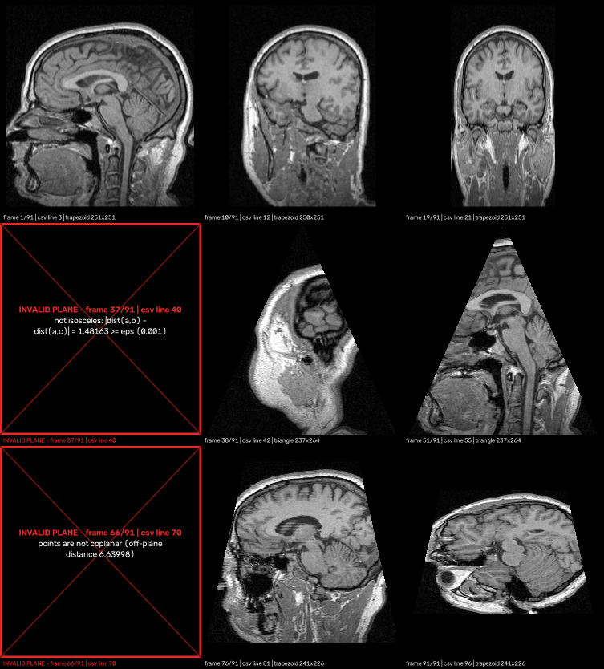

# Ex1 — Plane Projection of a 3D Volume

*Introduction to Software Engineering (OOP / OOD), Ex1*

This project samples a 3D raster volume `M` (an MRI or CT scan stored as **NRRD**) on an
arbitrary plane `p`. The result is a 2D image. A demo renders a whole list of planes from a CSV file into an **mp4** video.



## Problem and scope

**Input.** A 3D matrix `M[x][y][z]` of size `sx·sy·sz` (`1 ≤ s < 2^10`, unsigned 8/16/32-bit values),
and a plane defined by

* **3 points** `(a, b, c)` with `dist(a,b) = dist(a,c)`: an isosceles triangle, or
* **4 points** `(a1, a2, b, c)` with `dist(a1,b) = dist(a2,c)`, `dist(a1,a2) ≤ dist(b,c)`, all
  coplanar: an isosceles trapezoid. Equality is checked with tolerance EPS = 0.001.

**Output.** An image `E` with `floor(Dab)+1` rows (from the apex down to the base) and `floor(Dbc)+1`
columns. Each pixel shows the **closest voxel** of the point it represents. Points outside `M`, and
pixels outside the shape, are 0.

**In scope:** NRRD reading, plane validation, the projection algorithm, the demo, the documentation, the
dataset, tests, a benchmark and the experiment. **Out of scope:** a GUI, interpolation /
super-resolution, multi-channel and 4D volumes. Details are in the [SRS](docs/SRS.md).

## Documents

| Document | Contents |
|---|---|
| [docs/SRS.md](docs/SRS.md) | Software Requirements Specification (functional and non-functional requirements, interfaces) |
| [docs/ALGORITHM.md](docs/ALGORITHM.md) | The algorithm in detail: design decisions, geometry, validation, why it is fast |
| [docs/DATASET.md](docs/DATASET.md) | NRRD volumes (MRHead, phantoms, 3D Slicer data) and plane CSV files |
| [docs/TESTING.md](docs/TESTING.md) | Testing strategy, including the demo and error handling |
| [docs/EXPERIMENT.md](docs/EXPERIMENT.md) | Experiment, benchmark and results |

## Build and run

Requirements: Python ≥ 3.9, NumPy, OpenCV.

```bash
git clone https://github.com/roneliyahu2001/oop-ex1-volume-plane-projection.git
cd oop-ex1-volume-plane-projection
python -m pip install -r requirements.txt
```

Run the demo (the format required by the assignment):

```bash
python Ex0.py data/MRHead.nrrd data/planes/mrhead_experiment.csv out.mp4
```

```
wrote out.mp4: 91 frames (87 valid, 4 error), 502x556, codec avc1
  invalid plane at csv line 40: not isosceles: |dist(a,b) - dist(a,c)| = 1.48163 >= eps (0.001)
  ...
projection: 55.4 ms total, 1571 fps; total run time 0.67 s
```

Options:

| Option | Meaning |
|---|---|
| `--fps 10` | Video frame rate |
| `--eps 0.001` | Validation tolerance |
| `--coordinates index\|world` | CSV points are voxel indices (default) or NRRD world coordinates (mm) |
| `--scale N` | Integer up-scaling of frames (default: automatic for small volumes) |
| `--window LOW HIGH` | Intensity window (default: 0.5–99.5 percentile of the volume) |
| `--no-captions` | Hide the caption line under each frame |
| `--frames-dir DIR` | Also save every frame as a PNG |

### CSV format

There is one plane per line: 9 numbers for a triangle, or 12 numbers for a trapezoid. Lines starting with `#`, blank
lines and a header line are ignored.

```csv
# triangle: ax,ay,az, bx,by,bz, cx,cy,cz
127.5,0,65, 0,255,65, 255,255,65
# trapezoid: a1x,a1y,a1z, a2x,a2y,a2z, bx,by,bz, cx,cy,cz
0,0,65, 255,0,65, 0,255,65, 255,255,65
```

An invalid line (wrong number of values, text, or points that break the definition) produces a red
**error frame** at its place in the video, with the line number and the reason. All other frames are rendered normally.

### Use as a library

```python
from volproj.volume import Volume
from volproj.plane import Plane, InvalidPlaneError
from volproj.projector import PlaneProjector

volume = Volume.from_nrrd("data/MRHead.nrrd")
plane = Plane.from_points([(127.5, 0, 65), (0, 255, 65), (255, 255, 65)])  # raises InvalidPlaneError if invalid
image = PlaneProjector(volume).project(plane)                              # numpy array E[y, x]
```

(Run from the repository root with `src` on the path: `PYTHONPATH=src python …`.)

## Tests and benchmark

```bash
python -m unittest discover -s tests -t . -v      # 44 tests
python benchmarks/benchmark.py                    # 500^3 volume, fps per voxel type
```

On an Apple M4, a `500³` volume runs at **238–470 fps** (the requirement is ≥ 100, and ≥ 30 is
mandatory). See [EXPERIMENT.md](docs/EXPERIMENT.md#2-performance).

## Results

| Video | Content |
|---|---|
| [results/mrhead_experiment.mp4](results/mrhead_experiment.mp4) | Main experiment: 91 planes (rectangles, triangles, trapezoids) and 4 error frames |
| [results/mrhead_world.mp4](results/mrhead_world.mp4) | The same rotation in world coordinates (mm), with correct aspect ratio |
| [results/phantom_u16.mp4](results/phantom_u16.mp4) | Synthetic phantom (uint16) |
| [results/invalid_only.mp4](results/invalid_only.mp4) | Error frames only |
| [results/slicer_CT-chest.mp4](results/slicer_CT-chest.mp4) | 3D Slicer CT chest (int32) |
| [results/slicer_RegLib_C01_1.mp4](results/slicer_RegLib_C01_1.mp4) | 3D Slicer MR brain tumour |

## Design

```
Ex0.py                  CLI: argument parsing, exit codes, summary
src/volproj/
  nrrd.py               NrrdHeader / read_nrrd / write_nrrd   – file format only
  volume.py             Volume        – the matrix M, flat buffer + zero sentinel, world↔index
  plane.py              Plane         – triangle / trapezoid, validation → InvalidPlaneError
  projector.py          PlaneProjector – the vectorised projection algorithm
  reference.py          reference_project – literal pseudo-code (test oracle)
  planes_csv.py         parse_planes_csv → PlaneRecord (plane or error per line)
  video.py              IntensityWindow, FrameRenderer (image / error frames), Mp4Writer
  demo.py               run_demo pipeline → DemoReport
tools/                  dataset generator, Slicer downloader, plane generator
benchmarks/             performance benchmark
tests/                  unit, integration and CLI tests
data/                   volumes and plane lists        results/  output videos + logs
```

Main design choices:

* **One responsibility per module.** File I/O, geometry, the algorithm, parsing, rendering and the CLI
  are separate, so each can be tested on its own. Exceptions are typed (`NrrdError`,
  `InvalidPlaneError`, `DemoError`).
* **A triangle is a trapezoid** whose top edge has zero length, so the projection has one code path.
* **Validation happens when a `Plane` is created.** A `Plane` object is always valid, so the projector does not check it again.
* **Inverse mapping.** Every output pixel computes the 3D point it shows. This avoids holes and collisions,
  and the whole frame can be computed with NumPy at once. A zero sentinel voxel removes all masking from the gather step.

## Submission

* Repository: <https://github.com/roneliyahu2001/oop-ex1-volume-plane-projection>
* Moodle: a text file with the ID(s) and this link.
