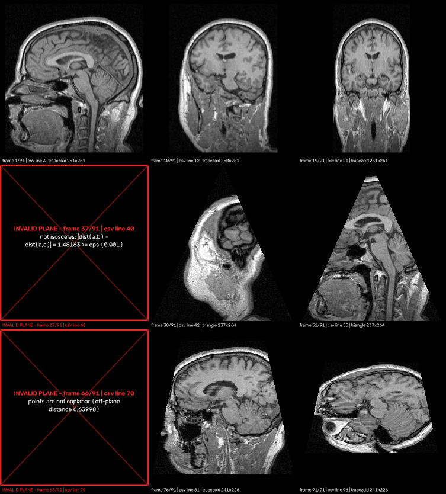
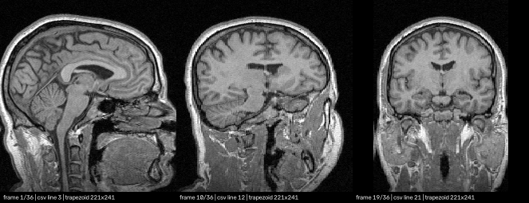
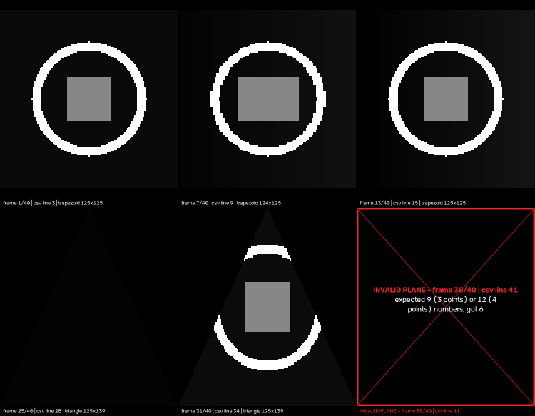

# Experiment and results

Machine: Apple M4 (macOS), Python 3.15, NumPy 2.5, OpenCV 5.0. All commands run from the repository root.

## 1. Demo on the MRHead MRI

```bash
python Ex0.py data/MRHead.nrrd data/planes/mrhead_experiment.csv results/mrhead_experiment.mp4
```

Output ([`results/mrhead_experiment.log`](../results/mrhead_experiment.log)):

```
wrote results/mrhead_experiment.mp4: 91 frames (87 valid, 4 error), 502x556, codec avc1
  invalid plane at csv line 40: not isosceles: |dist(a,b) - dist(a,c)| = 1.48163 >= eps (0.001)
  invalid plane at csv line 68: expected 9 (3 points) or 12 (4 points) numbers, got 6
  invalid plane at csv line 69: non-numeric value(s): abc
  invalid plane at csv line 70: points are not coplanar (off-plane distance 6.63998)
projection: 55.4 ms total, 1571 fps; total run time 0.67 s
```

Video: [`results/mrhead_experiment.mp4`](../results/mrhead_experiment.mp4) (91 frames, 10 fps).
Selected frames (row 1: rotating rectangle — sagittal → oblique → coronal; row 2: an error frame and
two sweeping triangles; row 3: an error frame and two tilted trapezoids):



**Observations**

* The rotation shows a sagittal slice at 0°, a coronal slice at 90°, and smooth oblique slices in
  between. Anatomy is continuous from frame to frame, with no seams or holes.
* Triangles and trapezoids have clean, symmetric edges. Each row is centred, as in the pseudo-code.
* Every invalid line became exactly one red error frame at its position in the list. The frames
  before and after it are unaffected.
* In index coordinates the coronal view looks narrow: MRHead voxels are 1.3 mm along index `z`,
  so one index step is not one millimetre. This is expected (see §3).

## 2. Performance

```bash
python benchmarks/benchmark.py --reference
```

`500³` random volume, 300 planes per family, median of 5 runs, projection only:

| voxel type | plane family | output size (typ.) | fps |
|---|---|---|---|
| uint8 | axial rectangle | 500x500 | 470 |
| uint8 | oblique triangle | 500x558 | 270 |
| uint8 | random trapezoid | 306x453 | 409 |
| uint16 | axial rectangle | 500x500 | 439 |
| uint16 | oblique triangle | 500x558 | 253 |
| uint16 | random trapezoid | 306x453 | 386 |
| uint32 | axial rectangle | 500x500 | 428 |
| uint32 | oblique triangle | 500x558 | 238 |
| uint32 | random trapezoid | 306x453 | 354 |
| any | literal pseudo-code in pure Python, 1 frame | 500x558 | ≈ 5 |

* Requirement: ≥ 30 fps (must), ≥ 100 fps (expected). **Result: 238–470 fps** for every voxel type.
  The vectorised projector is about 50× faster than the literal per-pixel loop.
* Axis-aligned planes are fastest: their gather reads memory almost sequentially. Oblique planes
  jump across the 125–500 MB volume and are limited by memory access.
* Real volumes in the demo: MRHead ≈ 1500 fps, CT-chest (512×512×139, int32) ≈ 560 fps,
  MRBrainTumor1 ≈ 2300 fps.

## 3. Index vs. world coordinates

```bash
python Ex0.py data/MRHead.nrrd data/planes/mrhead_world.csv results/mrhead_world.mp4 --coordinates world
```

The same rotation, but the points are given in LPS millimetres and the projector steps
1 mm per pixel. The coronal frame now has the correct anatomical proportions
([`results/mrhead_world.mp4`](../results/mrhead_world.mp4)):



## 4. Agreement with the literal pseudo-code

We compared the projector with `reference_project` (the pseudo-code transcribed line by line) on
15 planes of the MRHead experiment:

| Metric | Value |
|---|---|
| Footprint overlap (IoU of non-zero pixels) | 0.994 |
| Pixels with the identical voxel value | 72 % |
| Mean absolute difference (value range 0–279) | 1.99 |
| Largest difference in sampled voxel position (synthetic test) | 1 voxel |

The differences come from one decision. The pseudo-code samples at integer steps `x1` and then
rounds the column `x`. Our projector samples at the exact pixel centre. So a pixel may take the
neighbouring voxel; the image is not shifted by up to half a pixel, and it has no holes. Visually
the two are the same. This matches the answer to Q&A #4: "if it is close enough it is O.K."

## 5. Other data

* Phantom (uint16), with known shapes and 4 invalid lines: [`results/phantom_u16.mp4`](../results/phantom_u16.mp4)

  

* Only invalid planes → 4 error frames: [`results/invalid_only.mp4`](../results/invalid_only.mp4)
* 3D Slicer CT chest (int32): [`results/slicer_CT-chest.mp4`](../results/slicer_CT-chest.mp4)
* 3D Slicer MR brain tumour: [`results/slicer_RegLib_C01_1.mp4`](../results/slicer_RegLib_C01_1.mp4)

For CT, the automatic 0.5–99.5 % window includes air and bone, so soft tissue looks flat. Use
`--window -160 240` for a soft-tissue window. Note also that "outside the volume = 0" shows as
grey in CT (0 HU is water), as the specification requires.

## 6. Conclusions

* The projection is correct: exact on axis-aligned planes, consistent with the pseudo-code, and
  geometrically verified by the self-describing test volume.
* It is fast: well above the 100 fps target for `500³` volumes, in pure Python + NumPy.
* It is robust: each invalid plane is isolated to its own error frame. Fatal input problems are
  reported with clear messages and an exit code.
